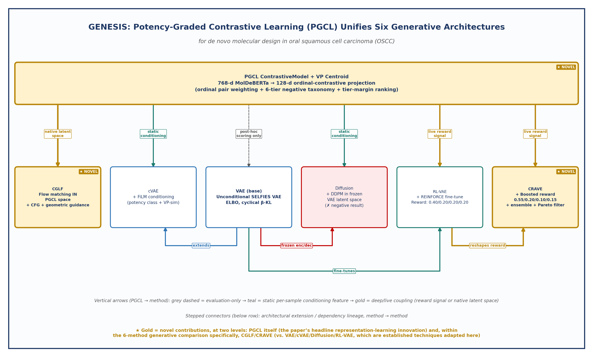

# GENESIS: Potency-Graded Contrastive Learning for Generative Molecular Design and Drug Repurposing in Oral Squamous Cell Carcinoma

**GENESIS** is an end-to-end computational drug discovery pipeline for oral squamous cell carcinoma (OSCC) that integrates ordinal contrastive representation learning (PGCL), multi-method molecular generation, structure-based docking, ADMET/network-pharmacology profiling, and drug repurposing screening.

> **Paper**: "GENESIS: Potency-Graded Contrastive Learning for Generative Molecular Design and Drug Repurposing in Oral Squamous Cell Carcinoma"
> GitHub: [github.com/gpt-sb/GENESIS](https://github.com/gpt-sb/GENESIS)

Every numeric claim in the paper is traced to a specific result file in this repository and can be independently re-derived — see [Verifying the Reported Numbers](#verifying-the-reported-numbers) below.

---

## Overview

The pipeline spans 11 phases, reproducible on a single consumer machine (Apple M3, 18 GB RAM):

| Phase | Description | Runtime |
|---|---|---:|
| 0 | MolDeBERTa embedding extraction | ~45 min |
| 1 | Data preparation (positives, negatives, scaffold-aware splits) | ~3 min |
| 2 | PGCL contrastive training (3 seeds) | ~72 min |
| 3 | Generative model training (6 methods × 5 seeds) | ~27 h |
| 4 | Bioactivity profiling of generated molecules | ~2 min |
| 5 | Baselines + ablations (comparative validation) | ~12 h |
| 6 | Drug repurposing screening (23,308 compounds) | ~3 min |
| 7 | Molecular docking (AutoDock Vina, single + multi-target) | ~65 min |
| 8 | ADMET & mucosal-safety profiling | < 1 min |
| 9a/9b | Network pharmacology + scaffold-constrained lead optimization | ~2 min |
| 10 | Integrated final ranking | ~2 min |

**Key results** (this run, seed 42 unless noted): Spearman ρ = 0.555 ± 0.003 for potency ordering (3-seed); frozen model transfers to lung adenocarcinoma without retraining (full-coverage pooled ρ = 0.207, n = 52,373 across 14 assessable targets, strongly along the PI3K/AKT/mTOR axis); 5,416 unique generated molecules; 316 recommended compounds, 46 Tier-1 fully-validated candidates, 13 triple-validated elite structures; 23,308 repurposing candidates screened.



*PGCL (ordinal potency-weighted contrastive learning) is the shared representation-learning foundation for six generative architectures; vertical arrows show each method's coupling depth to PGCL, stepped arrows show architectural lineage. ★ marks the study's novel contributions. See [docs/Algorithm_Design.md](docs/Algorithm_Design.md) for full derivations.*

---

## Repository Structure

```
GENESIS/
├── data/                  Master compound dataset (All_Compounds_Unq_Std.tsv, required input)
├── modeling/              PGCL training, evaluation, baselines, ablations (Phase 1-2, 5)
│   ├── checkpoints/       best.pt -- canonical PGCL checkpoint (seed 42, tracked in git)
│   ├── validation/        Multi-seed checkpoints/logs, ablation results
│   └── baselines/         Flat SupCon, BCE, ECFP4 k-NN, QSAR, cross-cancer transfer
├── generative/            VAE, cVAE, Diffusion, RL-VAE, CGLF, CRAVE (Phase 3)
│   ├── checkpoints/       7 trained model files (~325MB total, via Zenodo -- see below)
│   └── outputs/seed_42/   Raw generated SMILES, all 6 methods, canonical seed (Phase 3)
├── scripts/               Embedding extraction, virtual screening enrichment (EF@K/BEDROC), ChEMBL extraction helper, Zenodo downloader
├── repurposing/           Drug repurposing screening (Phase 6) + results/
├── docking/               AutoDock Vina wrappers + receptor structures (Phase 7) + results/
├── admet/                 ADMET profiling with OSCC mucosal-safety filter (Phase 8) + results/
├── network_pharmacology/  Pathway/network analysis (Phase 9a) + results/
├── leadopt/                Scaffold-constrained lead optimization (Phase 9b) + results/
├── final_ranking/         Integrated GENESIS-score ranking (Phase 10) + results/ (.tsv + .xlsx)
├── negatives/             6-tier negative taxonomy TSVs
├── documents/             Manuscript ground-truth ledger, verifiers, figures
├── results/               Phase 4 bioactivity profiling, elite_candidates.tsv, COLUMNS.md (data dictionary)
├── test_reproducibility.py  Environment/file-layout sanity check (run first)
├── docs/
│   ├── Algorithm_Design.md PGCL algorithm/architecture reference (optional reading -- not required to reproduce results)
│   └── images/Fig_GENESIS_Graphical_Abstract.png  Methods overview figure shown above
├── requirements.txt
└── LICENSE
```

**Not included in git** (download from Zenodo — see below):
- `embeddings/` — MolDeBERTa CLS embeddings (~1.1 GB + ~0.3 GB ID index)
- `generative/checkpoints/*.pt` — trained generative model weights (~325 MB)

---

## Installation

```bash
git clone https://github.com/gpt-sb/GENESIS.git
cd GENESIS
pip install -r requirements.txt
```

Verify your environment and file layout before starting:
```bash
python test_reproducibility.py
```

**AutoDock Vina** (required for Phase 7):
```bash
# macOS
brew install autodock-vina
# or: pip install vina
```

---

## Large Files (Zenodo)

Pre-computed MolDeBERTa embeddings and trained model checkpoints are archived on Zenodo for permanent, citable, DOI-backed access:

> **DOI**: [10.5281/zenodo.23393588](https://doi.org/10.5281/zenodo.23393588)

```bash
python scripts/download_embeddings.py
```

The canonical PGCL checkpoint (`modeling/checkpoints/best.pt`) and its 3 multiseed variants are also tracked directly in this repository (small, <10 MB each) — they do not need to be downloaded to run the pipeline, but a permanent Zenodo copy is kept independent of GitHub's future availability, since this is the single most important artifact in the paper. The embeddings (~1.5 GB) and the 6 generative-method checkpoints (~325 MB) are Zenodo-only.

Without these files, start from Phase 0 (re-extracts embeddings, ~45 min) and Phase 3 (re-trains the generative models, ~27 h for all 6 methods × 5 seeds — or just seed 42 for a faster ~5.5 h single-seed run).

---

## Verifying the Reported Numbers

Every numeric claim in the manuscript is backed by a single, version-controlled ledger:

- **`documents/manuscript_ground_truth.json`** — every reported number, with its exact source result file.
- **`documents/verify_manuscript_numbers.py`** — re-derives each ledger entry directly from the underlying raw result files (independent of the ledger itself).

```bash
python documents/verify_manuscript_numbers.py
```

This is intended to let reviewers check any specific number (e.g. the cross-cancer transfer ρ, or Table 1's baseline comparisons) against its raw source file in under a minute, without rerunning the full pipeline.

---

## Result Files

Per-phase output tables (repurposing rankings, docking energies, ADMET profiles, network pharmacology, lead-optimization analogs, and the integrated final ranking) are included directly so reviewers can inspect actual study outputs without rerunning the pipeline:

- **`results/elite_candidates.tsv`** — the 13 triple-validated elite compounds (docking + ADMET + selectivity concordant), the single most relevant "headline results" file.
- **`results/COLUMNS.md`** — data dictionary explaining the non-obvious column names across all result tables below.
- **`generative/outputs/seed_42/`** — raw generated SMILES for all 6 methods (canonical seed 42).
- Per-phase `results/` subfolders under `repurposing/`, `docking/`, `admet/`, `leadopt/`, `network_pharmacology/`, and `final_ranking/` (the last also includes `.xlsx` spreadsheet versions).

---

## Reproducing the Paper Results

All commands auto-detect the best available device (`mps` / `cuda` / `cpu`) internally; pass `--device cpu` to force CPU execution on the scripts that expose this flag (noted per-phase below). Phases without a `--device` flag have no CLI arguments at all and run as shown.

### Phase 0 — MolDeBERTa embedding extraction *(skip if Zenodo files downloaded)*
```bash
python scripts/moldeberta_embedding_extract.py
# Runtime: ~45 min | Output: embeddings/compound_embeddings.mmap (~1.1 GB)
```

### Phase 1 — Data preparation
```bash
python modeling/prepare_positives.py   # -> modeling/positives.tsv (49,312 rows)
python modeling/prepare_negatives.py   # -> modeling/negatives.tsv (643,332 rows)
python modeling/compute_scaffolds.py   # -> Murcko scaffold groups
python modeling/create_splits.py       # -> modeling/splits.json (70/15/15, scaffold-aware)
python modeling/build_index.py         # -> modeling/compound_index.pkl
```

### Phase 2 — PGCL contrastive training (3 seeds)
```bash
python modeling/multiseed_train_eval.py --device mps
# Runtime: ~72 min | Output: modeling/validation/multiseed/checkpoints/best_seed{42,123,456}.pt
# Expected: Spearman rho = 0.555 +/- 0.003, cliff accuracy = 66.4% +/- 0.3%,
#           target-switch AUROC = 0.967 +/- 0.001
```

### Phase 3 — Generative model training (6 methods x 5 seeds)
```bash
python generative/multiseed_gen.py --seeds 42 123 456 789 1337 --device mps
# Runtime: ~27 h (or ~5.5h for seed 42 only via generative/run_all.py)
```

### Phase 4 — Bioactivity profiling
```bash
python generative/evaluate_gen.py
# Expected: 5,416 unique molecules, 1,031 consensus hits, 14.6% safety PASS
```

### Phase 5 — Baselines and ablations
```bash
python modeling/baselines/run_all_baselines.py --device mps
python modeling/run_ablations.py --device mps
# Expected: PGCL wins 4/5 metrics vs Flat SupCon and vs BCE (Table 1)
```

### Phase 6 — Drug repurposing
```bash
python repurposing/run_drug_repurposing.py --device mps
# Expected: 23,308 candidates screened, top hit Erlotinib Hydrochloride (RW=0.8724)
```

### Phase 7 — Molecular docking *(requires AutoDock Vina)*
```bash
python docking/run_molecular_docking.py
python docking/run_multitarget_docking.py
# Expected: 361/364 successful single-target docks, 50/50 multi-target elite binders
```

### Phase 8 — ADMET profiling
```bash
python admet/run_admet_profiling.py
# Expected: 13 triple-validated elite candidates
```

### Phase 9a/9b — Network pharmacology and lead optimization
```bash
python network_pharmacology/run_network_pharmacology.py
python leadopt/run_lead_optimization.py
# Expected: 890 unique analogs from 13 elite parents
```

### Phase 10 — Final ranking
```bash
python final_ranking/run_final_ranking.py
# Expected: 316 recommended compounds, 46 Tier-1, top hit OMIPALISIB
```

### Figures
```bash
python scripts/create_all_paper_figures.py
```

---

## Reproducing the Cross-Cancer Transfer (OSCC→LUAD) Result

Two ways to inspect this result:

**Option A — pre-computed results (recommended, no database required):**

| File | Contents |
|---|---|
| `modeling/baselines/results/cross_cancer/transfer_results_target_based_full_coverage.json` | Manuscript-reported summary: pooled PGCL ρ = 0.2069, ECFP4 baseline ρ = 0.1841, n = 52,373 LUAD compounds across 14 assessable targets (100% coverage), per-target breakdown with bootstrap 95% CIs |
| `modeling/baselines/results/cross_cancer/luad_full_coverage_scored.tsv` | Per-compound PGCL and ECFP4 scores, target label, and measured pChEMBL, full coverage |
| `modeling/baselines/results/cross_cancer/full_coverage_provenance.json` | Provenance: which compounds were re-embedded vs. already indexed |
| `modeling/baselines/results/cross_cancer/transfer_results_target_based.json` | Superseded partial-coverage run (PGCL ρ = 0.5022, n = 29,675, 56.7% coverage, 4/16 targets) — kept for audit trail only, not the reported number |

**Option B — regenerate from scratch (advanced, requires a local ChEMBL MySQL mirror):**
```bash
export CHEMBL_MYSQL_HOST=localhost
export CHEMBL_MYSQL_USER=root
export CHEMBL_MYSQL_PASSWORD=your_password_here
export CHEMBL_MYSQL_DB=chembl_36
python modeling/baselines/cross_cancer_transfer_full_coverage.py --device mps
```
If `CHEMBL_MYSQL_PASSWORD` is unset, the script fails fast with a clear error rather than attempting a doomed database connection. The same environment-variable pattern is used by `scripts/chembl_oscc_extractor_v2.py`.

---

## Adapting GENESIS to Other Cancers

The PGCL framework is disease-agnostic; only the target list, positive/negative compound curation, and docking receptor structures are OSCC-specific. To adapt:
1. Replace the target list in `modeling/prepare_positives.py` / `prepare_negatives.py` with your disease's relevant targets.
2. Re-run Phases 0–2 to retrain PGCL on the new target set.
3. Swap `docking/receptors/` for your disease's crystal structures.
4. Phases 3–10 require no code changes — they operate on the frozen PGCL representation regardless of disease.

---

## Hardware

Developed and benchmarked entirely on a single Apple MacBook Pro (M3, 128 GB RAM) using PyTorch's MPS backend. No GPU cluster or cloud compute was used at any stage.

---

## Data

- ChEMBL bioactivity data (Mendez et al., 2019) for positive/negative compound curation.
- CompoundList repurposing library (23,308 compounds).
- 8 OSCC-relevant PDB crystal structures for docking (AKT1: 3CQW, EGFR: 4HJO, FGFR1: 4V04, MDM2: 4HG7, MTOR: 4DRH, PIK3CA: 4JPS, PTGS2: 3LN1, STAT3: 6NUQ).

---

## Citation

See `CITATION.cff`.

## License

This repository is dual-licensed:
- **Code** (all `.py` files, pipeline/training/evaluation scripts) — MIT License, see [LICENSE](LICENSE).
- **Data and results** (`data/`, `negatives/`, all `results/` directories, generative outputs, manuscript ledger) — Creative Commons Attribution 4.0 International (CC BY 4.0), see [LICENSE-DATA](LICENSE-DATA). You are free to share and adapt this data for any purpose, including commercially, provided you give appropriate credit.

Large files hosted on Zenodo (pre-computed embeddings, generative-method checkpoints) are licensed CC BY 4.0 — see the Zenodo record metadata.
